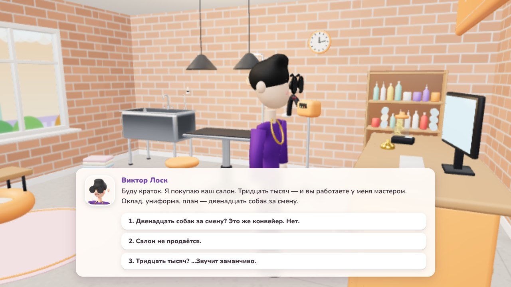
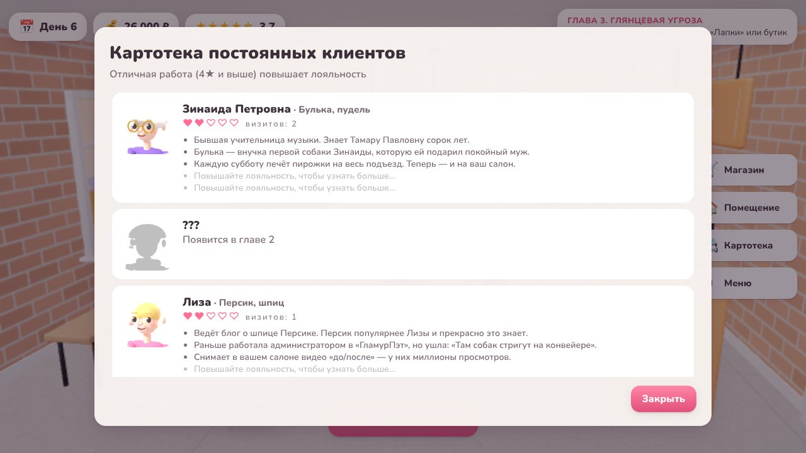

# 🐾 Пушистый салон — 3D-симулятор грумера

Откройте свой груминг-салон: купите помещение, соберите инструменты, мойте, сушите, вычёсывайте и стригите собак и кошек, заведите постоянных клиентов и победите на чемпионате «Золотые ножницы».

Все 3D-модели (6 пород питомцев, 14 персонажей, 30 предметов мебели, 10 инструментов) **сгенерированы скриптами Blender** из папки [`blender/`](blender/). Шерсть — многослойный шейдер, который в реальном времени реагирует на воду, шампунь, фен, пуходёрку, машинку и ножницы.


| | |
|---|---|
|  |  |
|  |  |

## Как запустить

Нужен [Node.js](https://nodejs.org/) 18 или новее.

```bash
npm install
npm run dev          # игра в браузере: http://localhost:5173
```

**Как отдельное приложение на ПК (Electron):**

```bash
npm run desktop      # собрать и открыть в окне (F11 — полноэкранный режим)
npm run dist         # установщик для Windows (.exe) в папке release/
npm run dist:linux   # AppImage для Linux
npm run dist:mac     # приложение для macOS
```

Если игра тормозит, в «Настройках» снизьте качество графики: меньше слоёв меха и без теней. Для автотестов есть параметры URL: `?q=low` (качество) и `?pr=0.5` (разрешение рендера).

## Управление

| Клавиша | Действие |
|---|---|
| ЛКМ по питомцу | работать инструментом |
| ПКМ / ЛКМ по пустому месту + движение | вращать камеру |
| Колесо мыши | приблизить или отдалить |
| `1`–`0` | выбор инструмента |
| `Q` / `E` или `Shift` + колесо | насадка машинки |
| `Tab` | подсказка длины: красный — длиннее нужного, синий — короче |
| `W` `A` `S` `D` | вращать камеру с клавиатуры |
| `Пробел` / `Enter` | продолжить диалог |
| `Esc` | пауза |

## Что внутри

**Сюжет из пяти глав и эпилога.** Наставница Тамара Павловна уходит на пенсию и вручает вам свои ножницы. Вы открываете салон, набираете клиентов, отбиваетесь от сети «ГламурПэт» Виктора Лоска, переезжаете в салон получше и выходите в финал чемпионата. Сюжет ветвится: есть альтернативная концовка, а постоянные клиенты могут вступиться за вас.

**Выбор и покупка салона.** Три помещения со своей атмосферой, ценой, арендой, вместимостью и наценкой:
- гараж «Хвостик» на окраине: кирпич, бетон, лампы на проводах;
- студия «Лапки» в спальном районе: паркет и обои с лапками;
- бутик «Grand Pet» на набережной: мрамор и неон.

При переезде старый салон продаётся за полцены.

**Магазин.** Инструменты (машинки «Стриж» и «Профи», японские ножницы, компрессор, когтерез...), косметика (гипоаллергенный и премиум-шампунь, парфюм, бантики, лакомства) и улучшения салона (диван, кофемашина, декор, неон, гидравлический стол, музыка, реклама). Улучшения сразу появляются в 3D-интерьере и влияют на игру.

**Постоянные клиенты.** Пять персонажей с собственными питомцами и историями:

| Клиент | Питомец |
|---|---|
| Зинаида Петровна | пудель Булька |
| студент Тимур | хаски Граф |
| блогер Лиза | шпиц Персик |
| профессор Аркадий Львович | кошка Маркиза |
| мама троих детей Ирина | корги Бисквит |

Каждый визит повышает или понижает лояльность. С ростом лояльности в картотеке открываются новые факты о клиенте, а чаевые растут. Ещё приходят случайные посетители с любыми породами и окрасами.

**Груминг.** Каждое состояние шерсти хранится в вершинах модели: грязь, колтуны, пена, влажность и длина.
- Шампунь лучше пенится на мокрой шерсти.
- Мокрую шерсть тяжело вычёсывать.
- Колтуны забивают простую машинку.
- Мокрая собака отряхивается и разбрызгивает воду.

Питомец нервничает, если долго дуть ему в морду или щёлкать машинкой у ушей; в этом случае помогают лакомства. Оценка складывается из качества каждого пункта заказа, времени и стресса и влияет на оплату, чаевые и репутацию.

## 3D-модели из Blender


| Файл | Что строит |
|---|---|
| [`blender/pets.py`](blender/pets.py) | Корги, пудель, хаски, шпиц, йоркширский терьер, кошка. Тела строятся из метаболов, затем идут воксельный ремеш и сглаживание. У каждой части (голова, уши, лапы, хвост) своя опорная точка для анимации. Глаза, нос и уши ставятся на поверхность рейкастом. В цвете вершин запечены маски окраса и роста шерсти, поэтому одна модель даёт много окрасов. |
| [`blender/people.py`](blender/people.py) | 14 персонажей с причёсками, очками, бородами и аксессуарами. Конечности на шарнирах для ходьбы и жестов. |
| [`blender/salon.py`](blender/salon.py) | Груминг-стол, ванна, фен-стойка, ресепшен, диваны, растения, стеллаж с флаконами, клетка, кофемашина, неон, сцена чемпионата, кубок «Золотые ножницы». |
| [`blender/tools.py`](blender/tools.py) | Пуходёрка, душ, фен, машинка, ножницы, шампунь, когтерез, парфюм, бантик, лакомство. |
| [`blender/renders.py`](blender/renders.py) | Рендерит в Cycles иконки инструментов и портреты персонажей для интерфейса. |


Готовые модели уже лежат в `public/models/`, а иконки и портреты — в `public/icons/` и `public/portraits/`. Чтобы пересобрать их после правки скриптов, запустите один из вариантов:

```bash
pip install bpy            # Blender как модуль Python (bpy 5.x — для Python 3.13)
npm run models             # = python3 blender/build_all.py

# или через установленный Blender:
blender --background --python blender/build_all.py
```

Превью любой части можно отрендерить отдельно, например так: `python3 blender/pets.py --preview /tmp/out`.

## Структура проекта

```
blender/            скрипты процедурного моделирования (bpy)
public/models/      GLB-модели, собранные Blender
public/icons/       иконки инструментов (рендер Cycles)
public/portraits/   портреты персонажей (рендер Cycles)
electron/main.cjs   десктопная обёртка
src/
  fur/              шейдер меха (shell fur)
  pet/Pet.js        питомец: мех, инструменты, анимация
  game/             игровой цикл, сюжет, день, клиенты, сессия груминга, сохранения
  world/            салон, NPC, камера, частицы, процедурные текстуры
  data/             породы, инструменты, магазин, салоны, клиенты, сюжет
  ui/               интерфейс
  audio/            синтезированный звук и музыка (WebAudio, без файлов)
test-fur.html       стенд для проверки меха всех пород
```

Игра сохраняется автоматически после каждого клиента и в конце дня.
