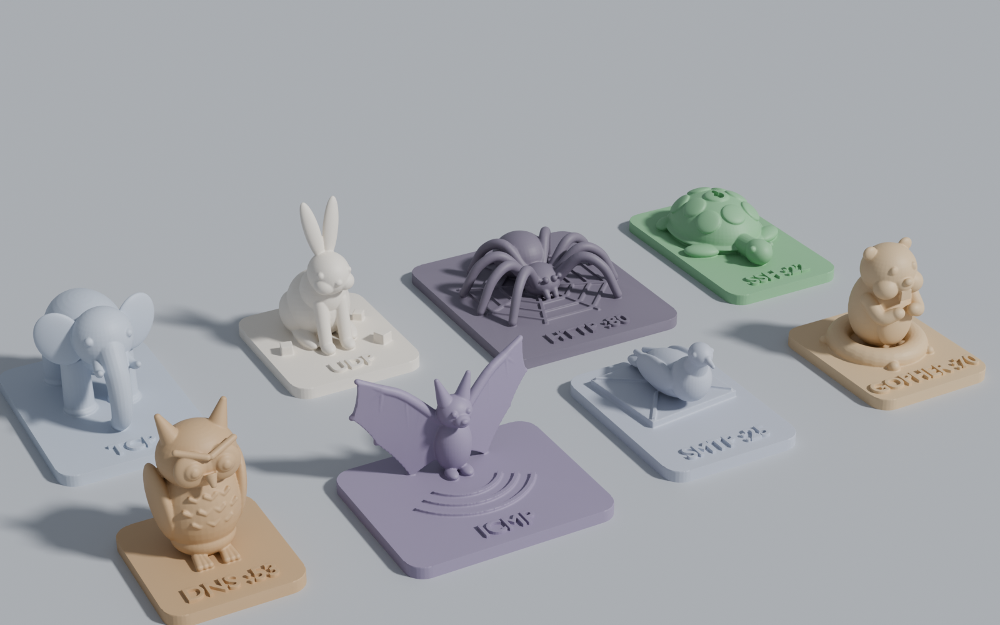
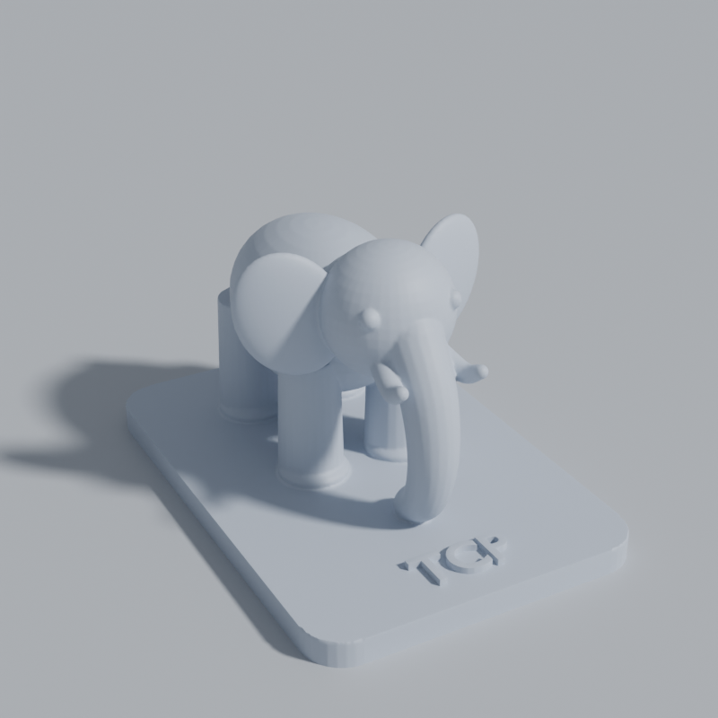
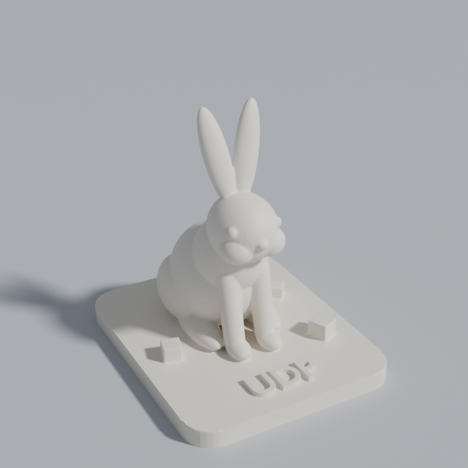
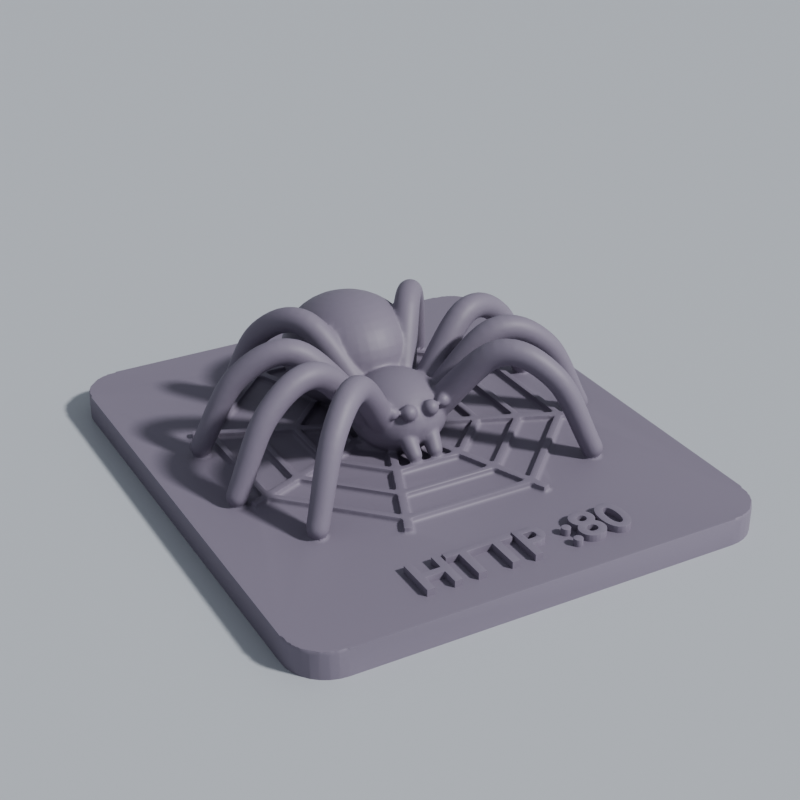
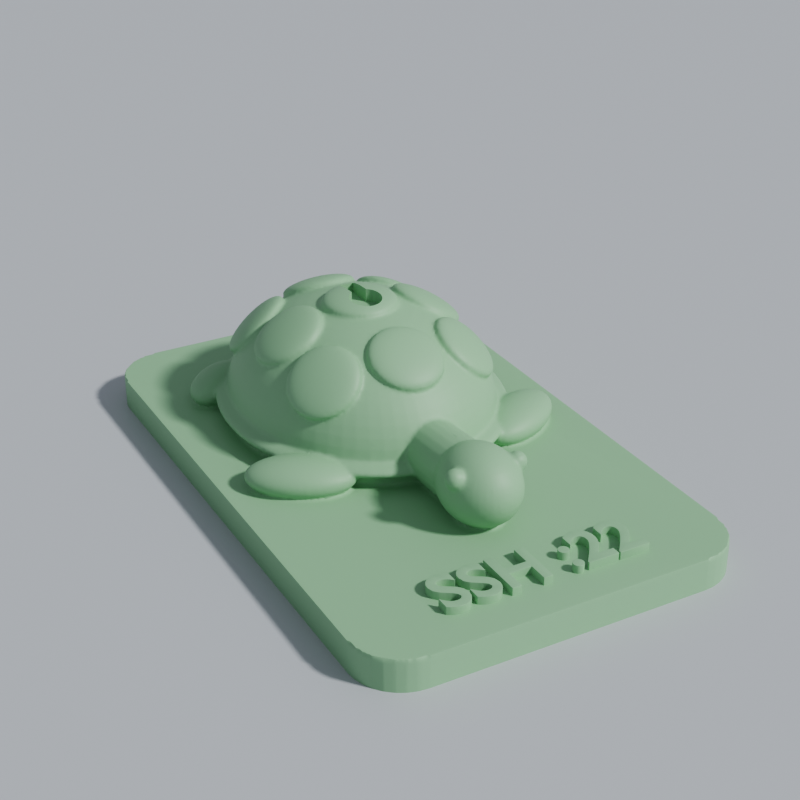
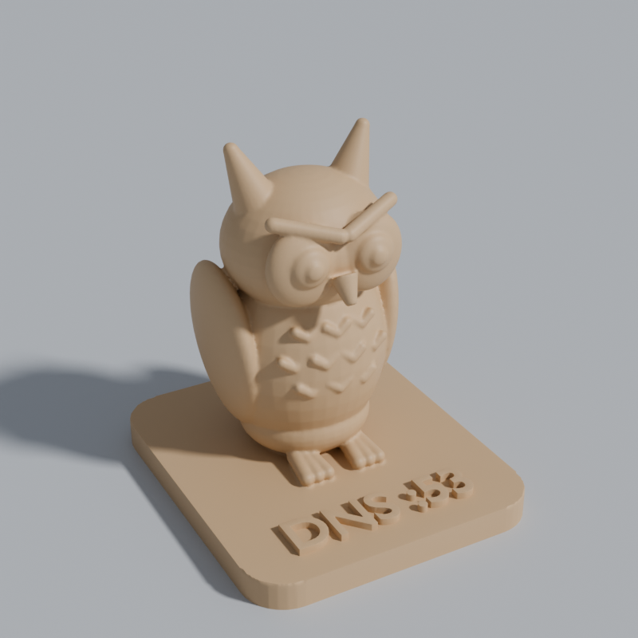
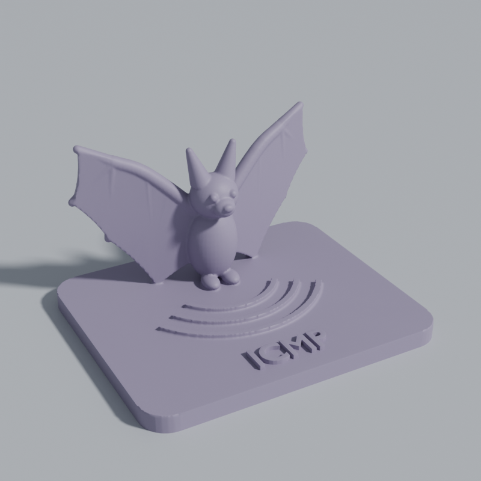
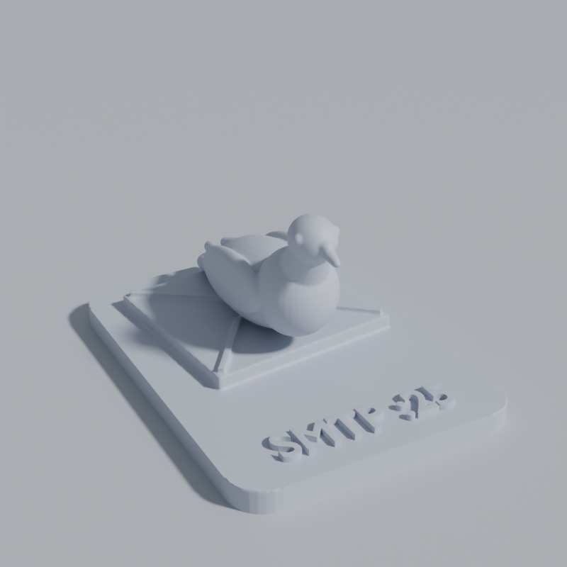
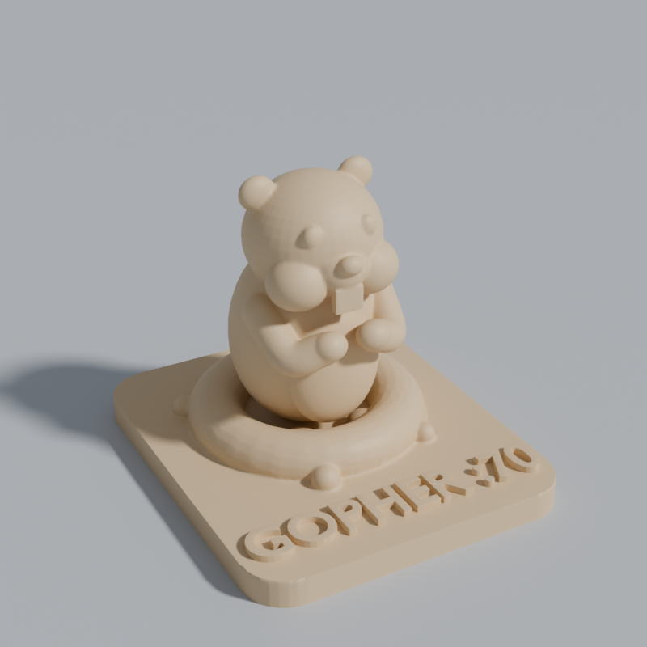

# Vsacoe — Network Zoo 🐘🐇🕷🐢🦉🦇🕊

Фигурки животных, которые ассоциируются с сетевыми протоколами. Сделаны в
Blender, готовы к 3D-печати. Каждая модель стоит на подставке, на подставке
выпуклая надпись с названием протокола (и портом, если он есть).



| Модель | Протокол | Почему это животное | Файл |
|---|---|---|---|
| Слон | **TCP** | «Слон никогда не забывает»: соединение с рукопожатием, гарантированная доставка, порядок пакетов. Надёжный, но тяжеловесный | [`stl/tcp_elephant.stl`](stl/tcp_elephant.stl) |
| Кролик | **UDP** | Быстро, без рукопожатий и подтверждений. Вокруг рассыпаны «датаграммы»-кубики, которых никто не ждёт обратно | [`stl/udp_rabbit.stl`](stl/udp_rabbit.stl) |
| Паук | **HTTP :80** | World Wide **Web**. Паук сидит на паутине, паутина выпуклая, на подставке | [`stl/http_spider.stl`](stl/http_spider.stl) |
| Черепаха | **SSH :22** | **S**ecure **SH**ell: всё спрятано под панцирем. На центральном щитке вырезана замочная скважина (SSH-ключи) | [`stl/ssh_turtle.stl`](stl/ssh_turtle.stl) |
| Сова | **DNS :53** | Мудрая сова знает имена всех хостов, как телефонная книга интернета | [`stl/dns_owl.stl`](stl/dns_owl.stl) |
| Летучая мышь | **ICMP** | Эхолокация — это и есть `ping` (echo request / echo reply). Перед мышью эхо-волны | [`stl/icmp_bat.stl`](stl/icmp_bat.stl) |
| Голубь | **SMTP :25** | Почтовый голубь сидит на конверте. И привет RFC 1149 — «IP over Avian Carriers» | [`stl/smtp_pigeon.stl`](stl/smtp_pigeon.stl) |
| Суслик-гофер | **Gopher :70** | Протокол Gopher (RFC 1436) назван в честь талисмана Университета Миннесоты. Гофер выглядывает из норки | [`stl/gopher_gopher.stl`](stl/gopher_gopher.stl) |

<p>
 
 
 
 
</p>

## Файлы

- `stl/*.stl` — готовые к печати модели (бинарный STL, единицы — миллиметры).
- `network_zoo.blend` — все 8 моделей в одной сцене Blender (единицы — мм), с
  материалами, светом и полом для рендера.
- `blender/network_zoo.py` — скрипт, который строит модели с нуля. Вносите
  правки в нём и пересобирайте, всё воспроизводится.
- `previews/*.png` — рендеры (Cycles).

## Размеры и проверка сеток

Все модели проверены скриптом: одна замкнутая оболочка, 0 неманифолдных рёбер,
дно ровно в z = 0, примерно 90 тыс. треугольников.

| Модель | Габариты X×Y×Z, мм | Объём, см³ | Нависания > 45°, см² |
|---|---|---|---|
| TCP — слон | 50 × 72 × 42 | 35.2 | 5.3 |
| UDP — кролик | 46 × 55 × 54.5 | 20.9 | 2.0 |
| HTTP — паук | 68 × 78 × 20.6 | 28.9 | 2.4 |
| SSH — черепаха | 46 × 74 × 20 | 25.7 | 1.2 |
| DNS — сова | 42 × 48 × 49.5 | 22.8 | 1.5 |
| ICMP — летучая мышь | 68 × 56 × 39 | 19.7 | 0.8 |
| SMTP — голубь | 48 × 65 × 31 | 20.0 | 3.4 |
| Gopher — гофер | 46 × 54 × 42 | 22.3 | 2.6 |

## Печать (FDM)

Модели не печатались вживую. Рекомендации ниже сделаны по геометрии.

- Сопло 0.4 мм, слой 0.12–0.16 мм (для мелких деталей вроде глаз и надписей),
  2–3 периметра, заполнение 10–15 %.
- Печатать как есть, подставкой на стол. Поворачивать не нужно.
- Поддержки: древовидные (tree), только от стола.
  - **Слон** — поддержки нужны (живот между ногами, уши, бивни).
  - **Голубь, гофер, паук, кролик** — по желанию: нависают только кончик
    хвоста и крыльев, щёки и лапы, колени паука и подбородок кролика.
  - **Черепаха, сова, летучая мышь** — должны напечататься без поддержек.
    Крылья мыши — вертикальные пластины толщиной 2.2 мм.
- Масштаб можно менять в слайсере. При уменьшении меньше 70 % мелкие детали
  (когти совы, глаза, надписи) начнут теряться.

## Как пересобрать

Нужен Blender 4.5+ (нужен булев решатель Manifold; проверено на Blender 5.2).

```bash
# через установленный Blender
blender -b -P blender/network_zoo.py -- --out . --render

# или через модуль bpy из pip (Python 3.13 для bpy 5.x)
pip install bpy
python3 blender/network_zoo.py --out . --render
```

Опции: `--only tcp_elephant,dns_owl` собирает только выбранные модели,
`--voxel 0.2` делает сетку детальнее, `--faces 150000` задаёт число
треугольников в STL, `--no-blend` не сохраняет .blend.

Как устроен скрипт: каждое животное собирается из простых тел (эллипсоиды,
конусы, трубки по сплайну, пластины). Потом всё сшивается воксельным remesh в
одну герметичную оболочку. Надписи добавляются булевой операцией, чтобы буквы
остались чёткими. Сетка упрощается, а низ срезается по z = 0, чтобы дно было
идеально плоским.
